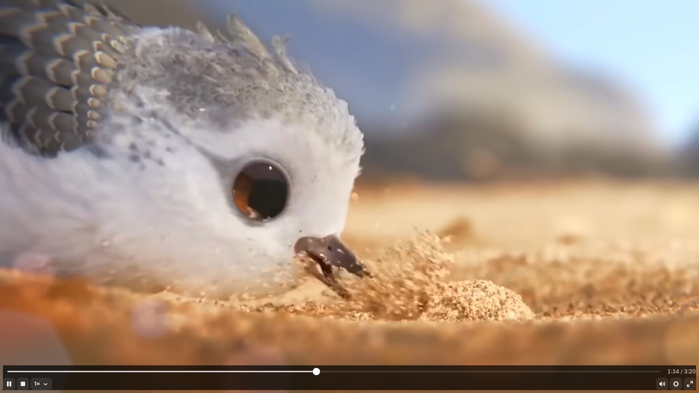
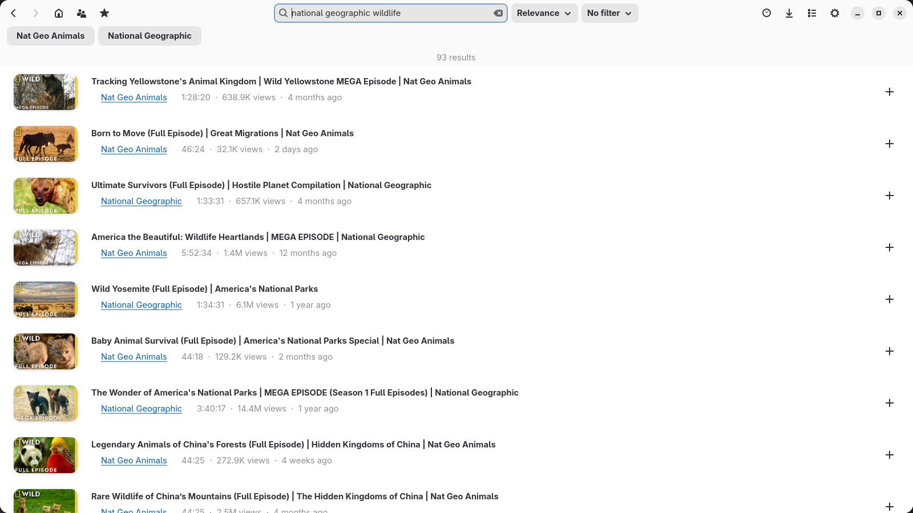
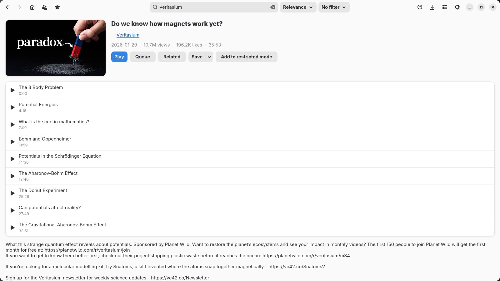
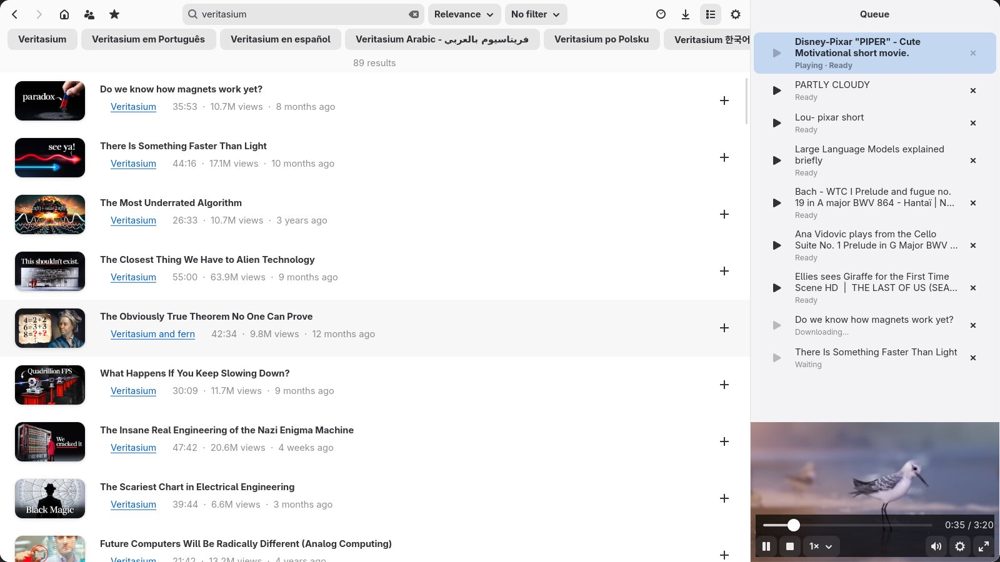
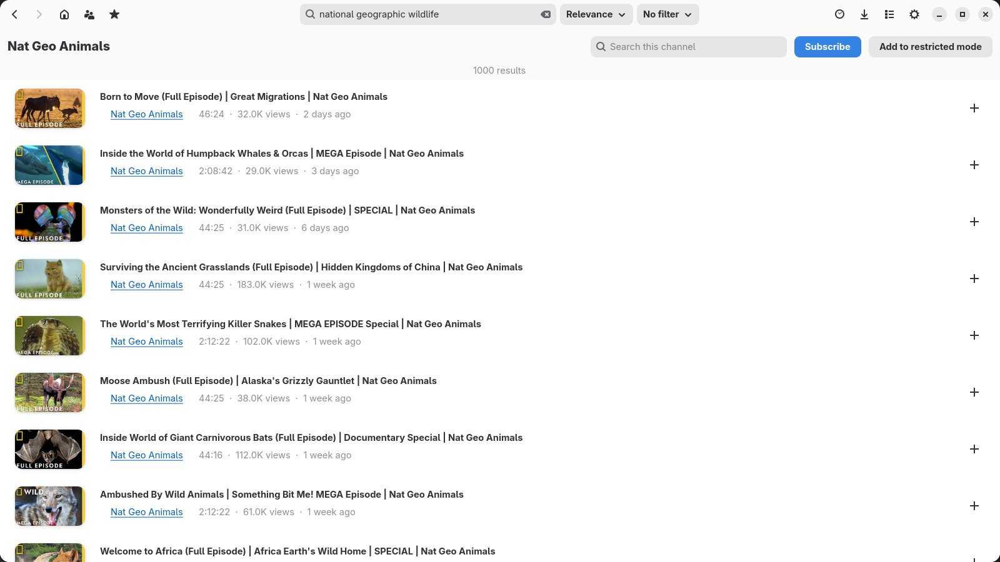
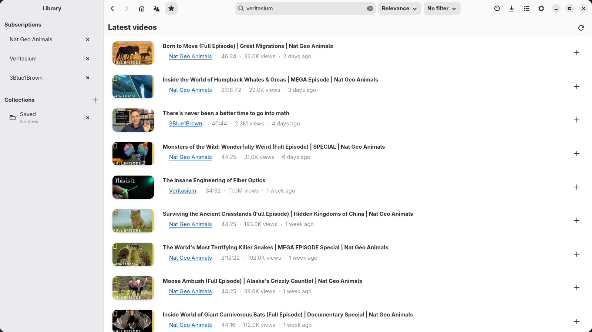
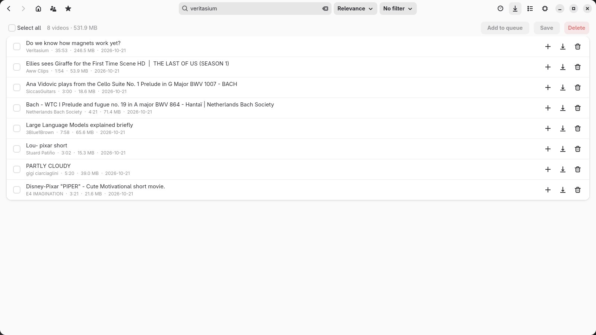
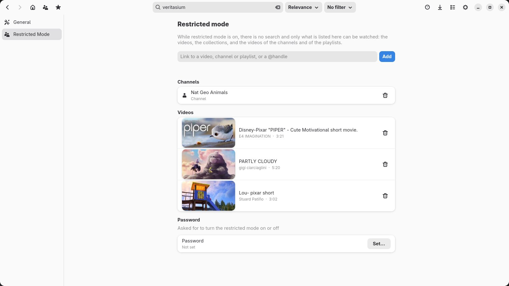
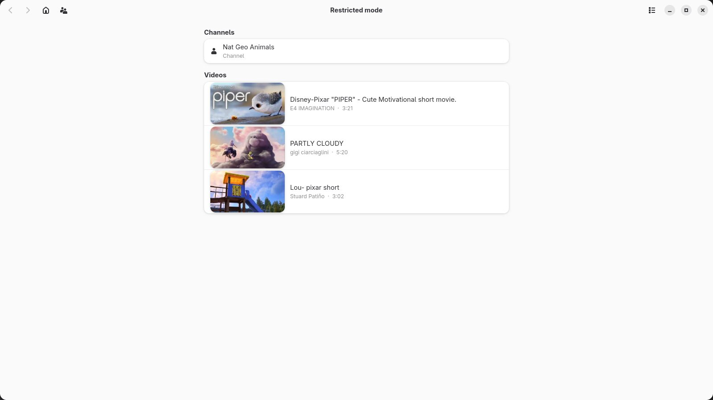

<p align="center"></p>

# Cathode


Cathode is a YouTube client for the desktop. Search for a video, hit play, and watch it in the built-in player. It may work.

# Features

## Search


- Search YouTube, with thumbnails, and the matching channels shown above the videos
- Titles in lists in the default language you choose, instead of YouTube's English ones
- Sort by relevance or date, and filter the results
- Paste a YouTube link to open the video directly

## Video pages


- Description, upload date and chapters, with chapters you can play one at a time
- Play, queue, see related videos, save to a collection, or allow in restricted mode
- Choose the video quality

## Queue and player


- A queue next to the player on every page, with downloads in progress shown in it
- Playback moves on to the next video by itself
- Drag videos to reorder the queue
- Picks up where you left off when you reopen the app
- Seekbar, playback speed, volume and fullscreen
- Subtitles in your default language and in the language of the video, automatic captions included, switched in the player settings, with the CC button or with `C`

## Links from the browser
- Cathode handles `cathode://play/?url=<YouTube link>` links, and opens a running window instead of a new one
- `packaging/cathode.user.js` is a userscript (Tampermonkey, Violentmonkey) that sends the page you are on to Cathode with `Alt+C`
- Or a Chrome extension that does the same, plus a right-click menu on YouTube links: Settings → Browser → Set up writes it to a folder and opens it, then load it from `chrome://extensions` (Developer mode → Load unpacked)
- Only one Cathode runs at a time: opening a link while it is running hands it to the open window
- Or from a terminal: `cathode https://youtu.be/dQw4w9WgXcQ`

## Channels


- Browse a channel's videos and search inside it
- Playlist pages too

## Subscriptions and collections


- Subscribe to channels without an account, and see their latest videos on the home page
- Keep videos you like in collections, or import a folder of videos you already have

## Downloads


- Watched videos are downloaded and cleaned up after 48 hours unless you save them
- A page to queue, save or delete downloaded videos, one by one or in bulk

## Restricted mode


- Parental controls: only the videos, channels, playlists and collections you allow can be watched
- Can be protected with a password



## And also
- `cathode --profile NAME` runs a separate Cathode with its own settings, history, downloads and cache, which can be open alongside the default one
- Back and forward navigation, with Alt+Left/Right and the mouse buttons
- Watch history
- Settings for download quality, sponsor segment skipping, speed limit, proxy and browser cookies for age-restricted videos

# Installation
Grab the files from the [latest release](https://github.com/andunieee/cathode/releases/latest), or use the commands below, which all download the latest one.

<details>
<summary>Linux</summary>

**Debian / Ubuntu** (Debian 13+, Ubuntu 25.04+), `.deb`:
```
curl -fL "$(curl -s https://api.github.com/repos/andunieee/cathode/releases/latest | grep -o 'https://[^"]*\.deb')" -o /tmp/cathode.deb && sudo apt install /tmp/cathode.deb
```

**Fedora and other RPM distros**, `.rpm` (needs [RPM Fusion](https://rpmfusion.org) enabled for `mpv-libs`):
```
curl -fL "$(curl -s https://api.github.com/repos/andunieee/cathode/releases/latest | grep -o 'https://[^"]*\.rpm')" -o /tmp/cathode.rpm && sudo dnf install /tmp/cathode.rpm
```

**AppImage**, saves it to `~/.local/bin` and runs it with `--install-desktop-entry`, which adds Cathode to the application menu and registers `cathode://` links for your user:
```
mkdir -p ~/.local/bin && curl -fL "$(curl -s https://api.github.com/repos/andunieee/cathode/releases/latest | grep -o 'https://[^"]*\.AppImage')" -o ~/.local/bin/cathode.AppImage && chmod +x ~/.local/bin/cathode.AppImage && ~/.local/bin/cathode.AppImage --install-desktop-entry
```
It needs FUSE (otherwise run it with `--appimage-extract-and-run`) and glibc 2.41+.

**Plain binary** (`.tar.gz`), for when you already have GTK 4.10+, libadwaita 1.7+ and libmpv installed. Same `--install-desktop-entry` flag:
```
mkdir -p ~/.local/bin && curl -fL "$(curl -s https://api.github.com/repos/andunieee/cathode/releases/latest | grep -o 'https://[^"]*linux-x86_64[^"]*\.tar\.gz')" | tar -xz -C ~/.local/bin cathode && ~/.local/bin/cathode --install-desktop-entry
```

**With cargo**, builds from source (see [Building from source](#building-from-source) for the dependencies):
```
cargo install --git https://github.com/andunieee/cathode
cathode --install-desktop-entry
```

There is also a `.flatpak` on the releases page: `flatpak install cathode-*.flatpak`.
</details>

<details>
<summary>Windows</summary>

**Manually**: download the `windows-x64-setup-` `.exe` from the releases page and run it. It adds a Start menu entry and an uninstaller and registers the `cathode://` links.

**One-liner** (PowerShell), does the same: downloads the installer and runs it.
```
$u=(irm https://api.github.com/repos/andunieee/cathode/releases/latest).assets.browser_download_url -match 'windows-x64-setup-v'; iwr $u -OutFile $env:TEMP\cathode-setup.exe; Start-Process $env:TEMP\cathode-setup.exe
```

**Portable** (PowerShell), no installer: downloads the `.zip`, unzips it to `%LOCALAPPDATA%\Cathode` and you start it with `cathode.bat`. No Start menu entry and no `cathode://` links.
```
$u=((irm https://api.github.com/repos/andunieee/cathode/releases/latest).assets.browser_download_url -match 'windows-x64-v.*\.zip$')[0]; iwr $u -OutFile $env:TEMP\cathode.zip; Expand-Archive -Force $env:TEMP\cathode.zip $env:LOCALAPPDATA\Cathode; & $env:LOCALAPPDATA\Cathode\cathode.bat
```
</details>

<details>
<summary>macOS</summary>

Apple Silicon only, and the app is unsigned.

**Manually**: download the `macos-arm64` `.zip`, double-click it in Finder to unzip, and drag `cathode.app` to `Applications`. On first launch right-click it and choose Open.

**One-liner** (Terminal), downloads and unzips it into `/Applications`. `ditto` is the archive tool that comes with macOS, and it keeps the app bundle intact where a plain `unzip` can break it:
```
curl -fL "$(curl -s https://api.github.com/repos/andunieee/cathode/releases/latest | grep -o 'https://[^"]*macos-arm64[^"]*\.zip')" -o /tmp/cathode.zip && ditto -x -k /tmp/cathode.zip /Applications
```

If macOS refuses to open it because it is from an unidentified developer, run:
```
xattr -d com.apple.quarantine /Applications/cathode.app
```
</details>

## Releases
Every `v*` tag publishes, on GitHub Releases: `.flatpak`, `.deb` (Debian 13+, Ubuntu 25.04+), `.rpm` (Fedora, with [RPM Fusion](https://rpmfusion.org) for `mpv-libs`), `.AppImage` and `.tar.gz` for Linux, a `.zip` and a `-setup-` installer for Windows and a `.zip` with `cathode.app` for Apple Silicon macOS.

## Building from source
### Dependencies
* rustc
* GTK 4.10+ and libadwaita 1.7+ (and their development headers)
* libmpv (and its development headers)
* Nothing else: on startup Cathode downloads yt-dlp (kept up to date daily), and ffmpeg/ffprobe and deno if they aren't in your `PATH`, into the `tools` folder of the cache (`~/.cache/cathode/tools` on Linux), verifying their checksums

### Running
Open the search page:
```
cargo run
```
